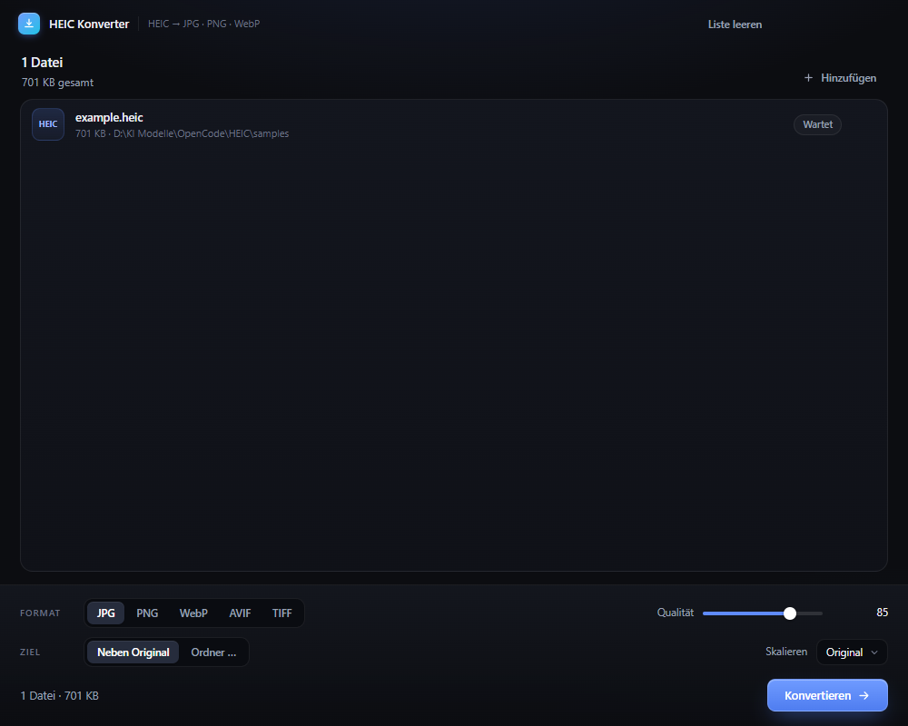

# HEIC Konverter

Eine kleine Desktop-App (Electron) für macOS, die **HEIC-/HEIF-Fotos in JPG, PNG, WebP, AVIF und TIFF** umwandelt – per Drag & Drop, in Stapeln, ohne Upload und ohne Cloud.

Unter Windows und Linux läuft sie ebenfalls (praktisch zum Entwickeln und Testen).



---

## Funktionen

- **Drag & Drop** von Dateien und ganzen Ordnern (Ordner werden rekursiv durchsucht)
- **„Öffnen mit“** aus dem Finder sowie Start mit Dateipfaden als Argument
- **Stapelkonvertierung** mit Fortschrittsanzeige und Abbrechen
- **Zielformate:** JPG, PNG, WebP, AVIF, TIFF
- **Qualitätsregler** für JPG, WebP und AVIF (PNG/TIFF sind verlustfrei)
- **Skalierung** auf max. 4096 / 2048 / 1600 / 1024 px (oder Originalgröße)
- **Zielordner** frei wählbar oder neben dem Original speichern
- **Kollisionsschutz:** vorhandene Dateien werden nie überschrieben (`Foto (1).jpg`)
- **Im Finder zeigen** pro Datei und für das Gesamtergebnis
- Alles läuft lokal auf dem Rechner

## Technik in Kurzform

| Schritt | macOS | Windows / Linux |
| --- | --- | --- |
| HEIC dekodieren | natives `sips` (ImageIO, sehr schnell) | `heic-decode` (libheif als WebAssembly) |
| Bilder kodieren | `sharp` (libvips) | `sharp` (libvips) |

Die Konvertierung läuft in einem **Worker-Thread**, damit die Oberfläche flüssig bleibt. Schlägt `sips` fehl (z. B. bei exotischen HEIF-Varianten), wird automatisch der WASM-Decoder verwendet.

---

## Entwicklung

Voraussetzungen: **Node.js 22.12+** und npm (Electron 45 setzt das für die Installation voraus).

```bash
npm install
npm start          # App starten
npm run dev        # mit DevTools
```

Unter Windows kannst du danach auch einfach **`HEIC Konverter starten.cmd`** doppelklicken – das öffnet die App ohne Terminal.

### Konverter-Logik testen

```bash
npm run test:convert -- /pfad/zu/foto.heic
```

Das Skript wandelt die Testdatei in alle Formate um, prüft die Ergebnisse mit `sharp` und legt sie in `test-output/` ab. (Liegt eine Datei unter `samples/example.heic`, genügt `npm run test:convert`.)

### Kommandozeile (ohne GUI)

```bash
node scripts/cli.js ~/Pictures/Urlaub --format webp --quality 82 --out ~/Desktop/export
```

Optionen: `--format jpg|png|webp|avif|tiff`, `--quality 1-100`, `--max-size <px>`, `--out <ordner>`.

---

## macOS-App bauen

> **Wichtig:** Ein `.dmg` für macOS lässt sich nur auf macOS bauen (Apple-Werkzeuge und Codesignatur). Es gibt zwei Wege: **GitHub Actions** (ohne eigenen Mac) oder einen lokalen Mac.

### Über GitHub Actions (ohne Mac)

Der Workflow `.github/workflows/build-mac.yml` baut auf den macOS-Runnern von GitHub je ein DMG + ZIP für **Apple Silicon (arm64)** und **Intel (x64)**.

1. Auf GitHub: **Actions → macOS Build → Run workflow → Run workflow**
2. Nach ca. 5–10 Minuten unten unter **Artifacts** herunterladen:
   - `heic-konverter-macos-arm64` (M1/M2/M3/M4)
   - `heic-konverter-macos-x64` (Intel-Macs)
3. DMG öffnen, App in den Ordner **Programme** ziehen und starten. Im DMG liegt die Datei **ANLEITUNG-MAC.txt** mit allen Schritten für den ersten Start.

Beim Push eines Tags (z. B. `git tag v1.0.0` und `git push --tags`) werden die Dateien zusätzlich an ein **GitHub-Release** gehängt – dort sind sie auch ohne Login herunterladbar.

Die App wird **ad-hoc signiert** (ohne Apple-Developer-Zertifikat). Das ist auf Apple Silicon Voraussetzung dafür, dass die App überhaupt startet. Beim ersten Start meldet Gatekeeper trotzdem, die App sei aus dem Internet geladen – siehe unten.

### Direkt auf einem Mac

```bash
npm install
npm run icon        # erzeugt build/icon.png (einmalig, optional)
npm run dist:mac    # erzeugt DMG + ZIP in release/
```

Standardmäßig entsteht ein Build für die **Architektur des Macs, auf dem du baust**. Das ist wichtig, weil `sharp` architekturspezifische Binaries enthält:

- Apple Silicon: `npm run dist:mac:arm64`
- Intel: `npm run dist:mac:x64` (am besten auf einem Intel-Mac ausführen)

Ein Universal-Build für beide Architekturen ist mit `sharp` nicht ohne zusätzliche Vorbereitung möglich – baue die Variante, die du brauchst.

### Erster Start (Gatekeeper)

Die App ist **ad-hoc signiert**, aber nicht notarisiert. Beim ersten Start aus dem Internet blockiert Gatekeeper sie deshalb. So lässt sie sich öffnen:

1. App nach **Programme** ziehen und doppelklicken (die Warnung erscheint).
2. **Systemeinstellungen → Datenschutz & Sicherheit** → unten bei „HEIC Konverter wurde blockiert“ auf **Trotzdem öffnen** klicken.

Alternativ einmalig im Terminal:

```bash
xattr -dr com.apple.quarantine "/Applications/HEIC Konverter.app"
```

Diese Anleitung liegt auch als **[ANLEITUNG-MAC.txt](ANLEITUNG-MAC.txt)** im Projekt und direkt im DMG-Fenster bei.

Für Weitergabe an viele Leute: mit Developer-ID signieren und notarizieren (siehe electron-builder-Doku, `CSC_LINK` / `APPLE_ID`).

### Troubleshooting

- **„Electron failed to install correctly“** beim Start: Die Electron-Binary wurde nicht heruntergeladen (passiert mit Node < 22.12). Einmalig nachholen:

  ```bash
  npx -y node@22 node_modules/electron/install.js
  ```

- **„App ist beschädigt“** auf macOS: meist nur die Quarantäne-Markierung, siehe oben (`xattr -dr …`).
- **`sharp`-Fehler nach Architekturwechsel:** `node_modules` löschen und auf der Zielarchitektur neu installieren.

### Windows/Linux (optional)

```bash
npm run dist:win
```

---

## Projektstruktur

```
src/
  main.js                 Electron-Hauptprozess, Dateidialoge, Worker-Steuerung
  preload.js              sichere IPC-Brücke (contextIsolation)
  converter-worker.js     Konvertierungs-Queue im Worker-Thread
  lib/
    heic.js               HEIC-Decoder (sips + libheif-Fallback)
    convert.js            Bildverarbeitung mit sharp
  renderer/
    index.html            Oberfläche
    styles.css            Styling
    app.js                UI-Logik
scripts/
  cli.js                  Kommandozeilen-Variante
  test-convert.js         Automatischer Format-Test
  make-icon.js            App-Icon generieren
samples/                  Testdatei
```

---

## Hinweise & Grenzen

- **Metadaten:** EXIF-/GPS-Daten werden nicht übernommen – die Ausgabe enthält nur die Bilddaten (gut für Datenschutz).
- **Live Photos:** Es wird nur das Standbild konvertiert, nicht das Videoteil.
- **Mehrbild-HEIC:** Es wird das primäre Bild verwendet.
- **Alpha-Transparenz** bleibt bei PNG, WebP, AVIF und TIFF erhalten; JPG bekommt einen weißen Hintergrund.
- **AVIF** ist das langsamste Format (einige Sekunden pro Bild), dafür sehr kleine Dateien.
- **HEIC-Ausgabe** ist bewusst nicht enthalten – die App konvertiert nur *von* HEIC *zu* gängigen Formaten.

## Lizenz

MIT
